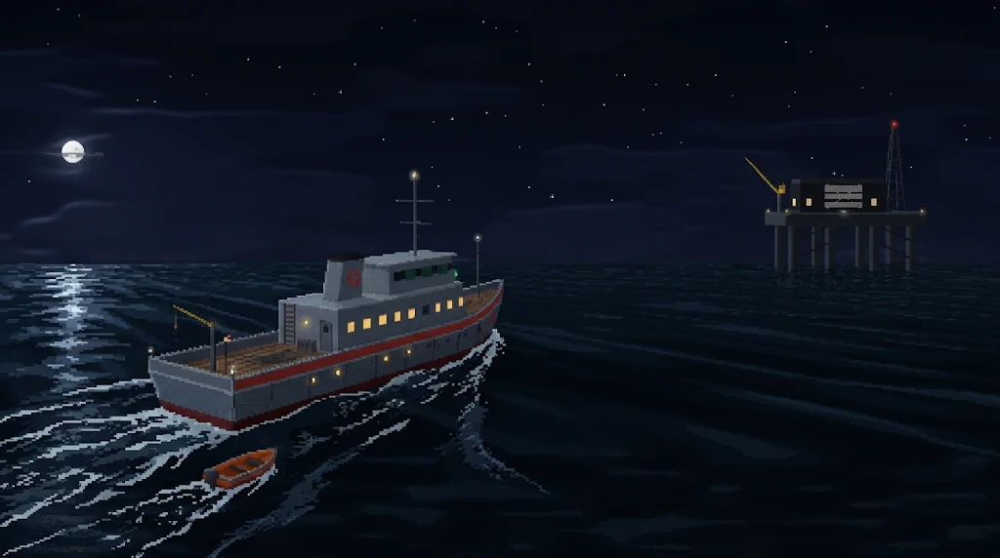
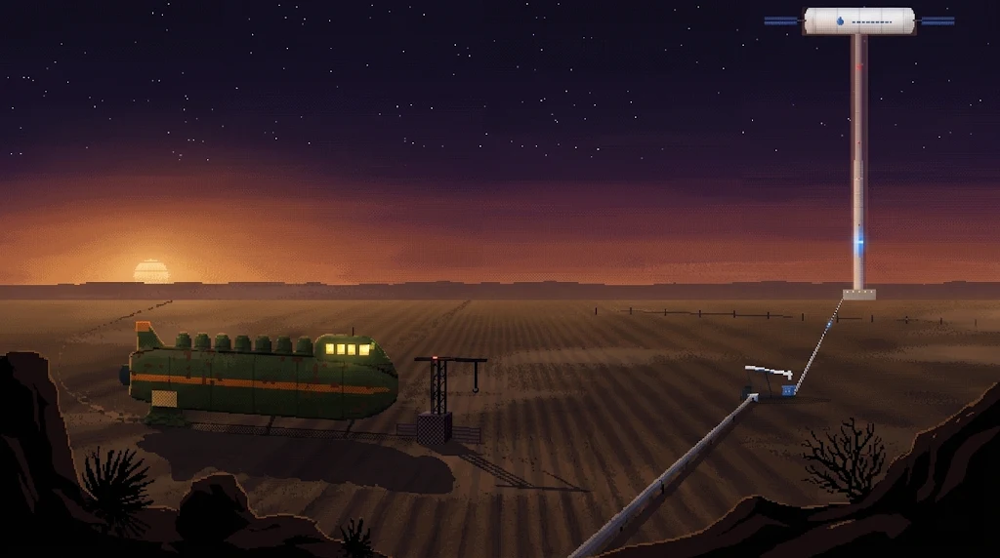

# Guia d'art: sales amb profunditat

> Per a qui dibuixa sales noves (o en refà una), o els personatges que hi caminen, en qualsevol dels quatre jocs. Recull l'anàlisi de les nostres sales
> al costat de referents de LucasArts (Fate of Atlantis, Monkey Island 2) i les guies de direcció d'art que ens han
> passat, i diu com aplicar-ho amb les nostres eines. Les captures de referència són a `docs/referencies/`. Exemple fet: el pont de la Cantimplora d'Aigua Verne
> (`games/aigua-verne/adapters/benne/tools/hd640/rooms/cantimplora_pont.py`).

## El problema: la casa de nines

Gairebé totes les sales que tenim són un **pla ortogonal frontal**: la paret del fons és paral·lela a la pantalla i
omple el quadre, el terra és una franja prima a baix (y 225–257), els objectes estan arrenglerats contra la paret a 90°,
la càmera és a l'altura dels ulls i no hi ha res entre la càmera i els personatges. Les poques sales amb profunditat
(l'Anell de Baix, els passadissos, el saló del palau) fan servir un sol punt de fuga central i simètric, que també fa de
decorat. Ve de com dibuixem: `rect` i `poly` en coordenades de pantalla donen línies horitzontals i verticals.

El 3D dels clàssics no ve de tenir més píxels: ve de **com trenquen la quadrícula**. Amb la mateixa paleta i el mateix
detall, el salt és enorme.

## Els principis

1. **Cantonada, no paret (dos punts de fuga).** La càmera mira de biaix cap a una cantonada: les dues parets fugen i
   el terra guanya un triangle de profunditat on es camina també en diagonal. Les coses importants poden anar a la
   paret que fuig (en escorç). Regla de les **tres cares**: de cada volum (consola, taula, caixa, casa) se'n veuen
   el davant, el costat i la part de dalt.
2. **Càmera picada o contrapicada, no a l'altura dels ulls.** Picada (alta, mirant avall) per a interiors, sales de
   control, carrers i molls: es veu la part de dalt de taules i panells i hi ha més terra per moure's. Contrapicada
   (baixa) per a sales grans o exteriors imponents.
3. **Primer pla que emmarca.** Alguna cosa molt a prop de la càmera, fosca o en silueta i tallada per la vora del quadre:
   una columna, una canonada, una biga, cables que pengen, caixes, una branca, unes roques. Fa tres plans (primer pla,
   personatges, fons) i «empeny» l'acció cap al mig.
4. **Trencar la rigidesa.** La línia on la paret toca el terra no és mai neta: caixes, cables, esquerdes, humitats,
   mobles que sobresurten. Els mobles **no** van enganxats a la paret ni a 90°: separats del fons i girats 20–45°.
   Les vores no són de regle: parets que fan panxa, marcs una mica deformats, horitzons amb desnivells.
5. **Superposició de plans.** El personatge ha de poder passar per darrere d'algunes coses (una taula, una barana, uns
   bidons) i per davant d'altres: quan un sprite queda mig tapat, el cervell llegeix un espai.
6. **La llum fa el volum.** Cada cara d'un volum té el seu to segons d'on ve la llum. Les ombres es projecten en diagonal
   pel terra i pugen per la paret del davant (la finestra, les persianes, els marcs). Bassals de llum sota els llums i
   foscor als racons.
7. **La textura també fuig.** Les esquerdes, les rajoles, la reixa del terra: grans i marcades a prop, petites i denses
   al fons. Al fons, menys contrast i el color tirant cap al de l'aire (perspectiva atmosfèrica).

## Com es fa amb les nostres eines

| Principi | Eina |
|---|---|
| Cantonada, tres cares, picat | `hd640/tres_d.py` (Aigua Verne): `Camera(pos, yaw, pitch, f, centre)` i `Escena`. La sala es descriu en el món (x, y amunt, z al fons; 1 unitat = 1 px a la distància on el personatge fa la seva mida) amb `quad`, `caixa`, `sprite` i `foscor`. El `yaw` dona els dos punts de fuga; el `pitch`, el picat. |
| Reaprofitar el detall | El que ja és dibuixat de cara (una paret amb el seu finestral, una consola, un seient) es dibuixa pla com sempre i es projecta com a textura: `quad(..., tex=(imatge, retall))`, o es posa dret com a `sprite`. |
| Decorats i animacions | Es dibuixen plans i es projecten per les mateixes superfícies amb `Escena.capa(...)`: el que hi ha davant els continua tapant. |
| Llum per cara, bassals | `Llum(pos, r, k)` del món: il·lumina cada cara segons cap on mira. `foscor(...)`: racons, ombres sota els mobles. |
| Primer pla i capes caminables | `FRONT`: una capa o una llista de capes `{'id', 'mask', 'baseline', 'zIndex'}` (la màscara, a partir de qui ha pintat cada píxel: `Escena.amo`). Amb `baseline` 999 tapa sempre (el primer pla); amb la y de la base d'un moble (el pou, la bomba, l'olivera al pati), el personatge hi passa per darrere o per davant (les eines posen a cada capa un `zIndex` creixent segons la línia base: si l'ordre de les capes no és el de la profunditat, el motor no pot complir totes les línies base i deixa el personatge darrere de totes). Al terra, `GEOMETRIA['forats']`: el moble no es trepitja però s'hi pot fer la volta. |
| Personatges que s'allunyen | `GEOMETRIA['regions']` amb una regió `scaleEnabled`: al terra, l'escala d'un personatge només depèn de la y de pantalla, i amb `Camera.escala()` es calcula exacta. Que no passi de ≈1,2 a prop (els fulls dels personatges són a 1×: ampliats, es pixelen). |
| Sales més amples que la pantalla | `ROOM_W` al mòdul de la sala (p. ex. el pati de la granja, 1280): la càmera segueix el personatge. |

Els quatre jocs tenen les mateixes eines: `hd640/tres_d.py` (una còpia a cada joc), el soroll `fbm` a
`hd/rooms/exterior.py`, `redibuixa_sala.py`, i `hd/render.py` i `draw_placeholders.py` amb les capes del davant, les
regions, els forats, l'ombra i `floorSquash`. A Ferro-9, la geometria de les sales que no són en 3D és a
`room_designs.py` (352×198); una sala en 3D porta la seva `GEOMETRIA` en píxels de 640 i la substitueix.

Més sobre les capes del davant (`FRONT`), après fent les sales:

- **Variants.** Una capa és un retall del fons de sempre, i es dibuixa per sobre: un decorat que canvia tota la sala
  (de dia, a les fosques, una alarma) quedaria tapat i el moble de davant sortiria «de nit» en una sala «de dia».
  `'variants': ('dia', 'fosc')` a la capa: les eines en fan la versió amb cada decorat (`dia__davant_timo`, retallada
  per la màscara, just a sobre i amb la mateixa línia base), i el runtime la mostra i l'amaga amb el decorat.
- **Props de damunt d'una capa** (el portàtil damunt del taulell): `'props': (...)` a la capa. Les capes van de 2 en
  2 de zIndex, i el d'enmig és per a aquests props i les variants.
- **Cap hotspot ni prop amb zIndex ≥ 10** a les sales amb capes del davant (els personatges són a 9–10): el motor no
  pot complir les línies base i deixa el personatge darrere de totes les capes.
- **Mobles que fan diagonal** a la pantalla (una consola, un banc girats): una sola línia base no deixa passar per
  davant d'una punta i per darrere de l'altra. La capa es talla en franges verticals, cadascuna amb la seva línia
  base (`_llesques`, a `fabrica_magatzem.py` de Ferro-9). La línia base d'un moble girat és la del cantó de davant
  que queda més al fons.

### Números que han funcionat (el pont)

- Càmera a 1,9 m (y = 190, una mica per sota del sostre), 3,8 m de la paret del fons, girada 7° (`yaw` −0,12) i
  mirant 9° avall (`pitch` 0,16), `f` = 380. Objectiu llarg: la paret del fons a escala ≈0,75 (el finestral fa 250 px),
  i els personatges entre 0,79 (al fons) i 1,25 (a prop).
- Amb un objectiu curt (`f` ≈ 230, la càmera a prop) la sala sembla una nau industrial: massa terra buit i parets
  enormes a les vores, i els personatges de prop surten el doble de grans.
- **Les sales en 3D són a 1× (640×360).** A 2× el pont tardava ≈1,5 min (sobretot el dibuix pla de les textures) i a
  1× tarda 25 s; amb la perspectiva i la llum, la diferència només es nota al detall petit projectat (rètols i
  agulles en escorç), i aquest detall, a 1×, s'ha de dibuixar prou gros. El sync del pont i el pati junts: ≈2 min.
  Els personatges també són a 1×.
- Per provar enquadraments, un esbós amb colors plans (segons) i imprimir on cauen les coses (`Camera.projecta`).

### Com es treballa una sala (Aigua Verne)

- El dibuix pla de sempre es mou a `<sala>_pla_comu.py` (font de les textures) i el mòdul de la sala munta l'escena 3D
  i la `GEOMETRIA` projectant punts del món. Els ids de `things`, `spawns`, `PROPS` i `ANIMS` no canvien.
- `python3 redibuixa_sala.py <sala>` escriu el full i la geometria d'una sala al joc (sense el sync sencer, que
  redibuixa totes les provisionals); `python3 hd/render.py <sala> <carpeta>` en fa previsualitzacions, amb una de
  depuració (el terra on es camina, les zones, els personatges).
- Es prova al joc: `window.__BENNE_HOOKS__` (`goToRoom`, `walkTo`) amb playwright, i es mira que l'escala, el
  terra, els clics i el passar per darrere vagin bé.
- Paranys: els forats del terra que la càmera aixafa fins a ≈2 px fan fallar el camí (millor treure'ls); `e.linia`
  amb punts darrere la càmera pinta milions de píxels; el `fbm` de la llibreria és lent per a superfícies grans (el
  palau en fa servir un de numpy); una sala amb un decorat al `PROPS` que no és al `.room.json` no el porta al joc.
- **La Cantimplora vista de fora és sempre la mateixa**: el model 3D de `hd640/rooms/cantimplora_comu.py`
  (`Cantimplora(popa, rumb, porta, escala, trams)` i `dibuixa(e, ...)`; el docstring en diu l'API, els punts i els
  sids). Cada sala la posa on vol i a la distància que vol, però no l'escala respecte de la gent.
- **Les coordenades fixes del guió** (`stage` amb `at`/`walk` `{x, y}` a `game/data/rooms/<sala>.json`, i `place` a
  `characters.json`) són en píxels de sala: quan el terra on es camina canvia, cal mirar que hi caiguin a dins (si
  no, el motor porta el personatge al punt més proper), i passar el sync perquè arribin al joc.
- Amb una càmera picada, la franja on es camina és estreta i l'escala hi creix de pressa: el terra on es camina es
  talla on el personatge arriba a ≈1,2, i el terra de més a prop queda per al primer pla.
- Els rètols petits, en escorç, no es llegeixen: s'han de dibuixar més grossos al pla (a Suma Zero, la font a 2× amb
  una N de 5 px: la de 4, en escorç, semblava una M). Si no hi caben, la lletra eixamplada (×1,5 o ×2 d'ample només:
  l'escorç aprima en horitzontal), i sempre fosca sobre clar (paper, esmalt, llautó): la lletra de color sobre la paret
  és la primera que es perd. Poden quedar una mica borrosos; n'hi ha prou que es llegeixin.
- Gent asseguda, poca: un personatge assegut en un seient en 3D (llitera, escala, caixa) no acaba de quedar real
  (el seient i el maluc no casen, les cames suren). Només quan un moble tapa les cames (la taula de la reunió del
  menjador, la Juana a la llitera amb les mantes); si no, dret o recolzat, i el text que ho digui.
- Quins rètols cal que es llegeixin: els que diuen alguna cosa que no surt enlloc més (peus de quadre, normes,
  avisos, cartells que orienten). Els noms de les portes no cal: el hotspot ja dona el nom en passar-hi per sobre, i
  fan de textura.

### Números que han funcionat (el pati de la granja)

- Exterior ample (1280): càmera a y = 140, sense mirar avall (`pitch` 0: les verticals, verticals) i l'horitzó a
  y = 110 de pantalla (`centre`), `f` = 500. Al terra, l'escala d'un personatge és (v − 110) / 140, exacta: d'1,06 a
  baix de tot a 0,37 a la porta del graner.
- El terra de l'exterior ha de ser molt ample (±80 km a 20 km de fons): si no, els marges entren a la pantalla a
  l'horitzó.
- Els solcs dels camps i les esquerdes, en coordenades del món: s'empetiteixen sols cap al fons, però a partir de
  ≈1.000 unitats fan moiré i s'han d'esvair.

## Els personatges dins la sala amb profunditat

Un personatge dibuixat per a la casa de nines, posat dins una sala en cantonada i picada, sembla un adhesiu pla
enganxat sobre el fons. Quatre ajustos el fan seure a l'espai, i el cinquè el fa viu:

1. **Vistes en 3/4, no només perfils.** Ara els fulls tenen tres direccions ortogonals (`L`, `D`, `U`; la `R` és el
   flip de la `L`). En una sala en cantonada el personatge gairebé sempre camina en diagonal, i amb el perfil estricte
   sembla que patini de costat. No calen vuit direccions: n'hi ha prou d'afegir el **3/4 de cara** (`DL`, caminant
   cap a baix-esquerra) i el **3/4 d'esquena** (`UL`, cap a dalt-esquerra); `DR` i `UR` surten del flip. En 3/4 es
   veuen les dues espatlles i els dos braços en escorç, i això ja dona volum. El motor ja ho fa servir: tria la
   direcció de les vuit (`facingFromWorldDelta`), fa el flip quan només hi ha la parella (`mirrorHorizontalFacing`) i,
   si una direcció no hi és, cau a la més propera; n'hi ha prou de posar les etiquetes `IdleDL`, `WalkDL`, `TalkDL`,
   `IdleUL`, `WalkUL`, `TalkUL` al full. El perfil es pot quedar per als desplaçaments purament laterals.
2. **Els peus també es veuen des de dalt.** Als fulls d'ara la càmera és a nivell de terra: les soles fan una línia
   horitzontal recta. Amb la càmera picada, quiet en 3/4 un peu queda una mica més amunt que l'altre (el de darrere),
   i la vora de baix dels pantalons, la faldilla o l'abric fa una lleugera corba cap avall, no una línia plana.
3. **Ombra de contacte, fora del sprite.** És el detall que més enganxa el personatge al terra i el que menys costa.
   No es dibuixa al full: és una el·lipse fosca semitransparent sota els peus que el motor pinta abans del sprite, i
   que s'escala amb ell. Si la sala té una llum clara en diagonal (la finestra, el sol del desert), l'el·lipse
   s'allarga i s'inclina en sentit contrari a la llum. Al motor és `characterShadow` de la sala (si no hi és, no
   hi ha ombra):

   ```json
   "characterShadow": { "alpha": 0.35, "squash": 0.3, "light": { "x": 330, "y": 215, "stretch": 0.8, "reach": 120 } }
   ```

   `squash` és com de picada és la càmera: l'alt de l'el·lipse respecte de l'ample. `light` és el punt del terra
   just sota el llum (un llum de sostre, el peu d'una finestra), en px de la sala. Just a sota, l'ombra és rodona, i
   a `reach` px ja té tota la llargada (`stretch` 1 = el doble de llarga). Per a un sol o una llum llunyana, el
   punt es canvia per una direcció: `"light": { "x": 1, "y": 0.3, "direction": true }`. A Aigua Verne es posa al
   disseny de la sala (`room_designs`), com `characterLights`, i el sync en passa les coordenades a la sala. Cada
   personatge hi pot posar `"shadow": { "width": 22 }` (l'ample a escala 1; per defecte, el 85% del collider) o
   `"shadow": false`.

   **Reflex al terra polit** (marbre, rajola molla): el reflex de la sala es pinta al fons (la mateixa escena des
   de sota el terra, girada, com al vestíbul del banc de Suma Zero), però el dels personatges el fa el motor amb
   `characterReflection`: una còpia del fotograma girada pels peus, amb la mateixa llum, que s'esvaeix lluny dels
   peus. Va just damunt del fons, sota tots els props: les capes del davant el tapen com tapen el personatge.

   ```json
   "characterReflection": { "alpha": 0.5, "fade": 0.1, "length": 0.9, "maxY": 259 }
   ```

   `alpha` és l'opacitat als peus (a 0,2 la roba fosca damunt els escacs ja no es veia), `fade` la del final (en
   fracció d'`alpha`), `length` l'alt respecte del personatge, i `maxY` on s'acaba el terra que brilla. A Suma Zero
   es posa a la `GEOMETRIA` de la sala; cada personatge hi pot posar `"reflection": false`.

   **La llum de la sala, també al personatge** (`characterLights`). El fons s'il·lumina quan es dibuixa; el full
   del personatge no, i sense això fa els mateixos colors al migdia, a la farga i a la coberta de nit: és la meitat
   de l'efecte adhesiu. El motor (`engine/room/characterLights.ts`) mostreja la llum a les quatre cantonades del
   sprite i el tenyeix en mode *overlay*: el valor 1 per canal (`#ffffff`) és neutre, per sota enfosqueix i per
   sobre il·lumina o acoloreix. Així, el costat que mira la pantalla o el foc s'encén i el racó fosc l'enfosqueix.

   ```json
   "characterLights": { "ambient": "#7c8aa8",
     "lights": [{ "x": 330, "y": 120, "radius": 260, "color": "#ffd28c", "intensity": 0.8, "whenPropHidden": "fosc" }] }
   ```

   `ambient` és la llum de tota la sala; cada llum suma `color × intensity` amb una caiguda fins a `radius` px
   (`squash`, `power` com a l'ombra). `whenPropVisible` / `whenPropHidden`: només mentre aquell prop es veu (el
   forn encès, el sol de la variant `dia`) o mentre no es veu (el llum que s'apaga amb el decorat `fosc`). El motor
   no avisa d'una clau mal escrita: el llum quedaria sempre encès (`npm run profunditat` sí que ho diu).
   Els valors no s'inventen: surten dels llums de l'escena (`LLUMS`, `Llum(pos, r, k)`), projectats amb la `CAM`
   de la sala (`llum_personatges` de `tres_d.py` a Aigua Verne, que abaixa els llums de sostre a l'alçada del pit;
   `_p(...)` a la centraleta de L'Última Arrel). Valors que han funcionat:

   | Sala | `ambient` | Llums |
   |---|---|---|
   | Interior fosc (farga, bodega, pont de nit) | ≈0,4–0,55, amb el to de l'art (`#645a54`, `#6e7690`) | cada làmpada o finestra a 0,2–0,7 |
   | Exterior de nit (coberta) | fred, `#7484a2` | els focus, càlids; el sol amb `whenPropVisible: 'dia'` |
   | Exterior de dia, sala clara (palau) | gairebé neutre (`#d6cdb6`, `#e6e6ee`) | un sol molt ample i suau, 0,12–0,6 |
   | Oficina fluorescent | fred i clar, `#b8bcc8` | els tubs a 0,2: a 0,4 la cara de la Vet es cremava |

   Ha de ser subtil: la cara s'ha de continuar llegint, i res de taques de color. Es comprova al navegador, amb el
   personatge a prop i lluny dels llums. A Aigua Verne va a la `GEOMETRIA` i `room_designs.py` la passa al disseny;
   en un joc nou, comproveu que aquest pas hi és (a Aigua Verne hi faltava, i cap sala no en tenia).
4. **Escala contínua i ordre de dibuix.**
   - L'escala ja és contínua: una regió `scaleEnabled` interpola linealment entre `scaleTop` i `scaleBottom` segons
     la y dels peus (`Camera.escala()` dona els valors exactes). Res de dues mides fixes amb un salt al mig. Els fulls
     són a 1×: reduir no deforma gaire la cara (el motor fa la mitjana dels píxels), i el límit és per dalt (≈1,2,
     vegeu més amunt). El màxim es mira on es camina de debò (la vora de baix de la zona caminable o els llocs on
     els personatges són quiets), no a la vora de la regió, que pot anar més avall (a final_galway semblava 1,85 i
     era 1,22). A 0,42 la cara de la Vet encara es llegeix; per sota de ≈0,4 cal mirar-ho a la pantalla.
   - **Mides de full diferents (`Lluny`).** El motor les tria per sala, no per franja: són una roba més
     (`outfit` amb `inRoom` a `characters.json`), i tot el full s'escala amb un sol `artScale`. Una figura molt
     més petita (o més gran) dins el mateix fotograma espatlla la velocitat de caminar, el `collider` i el
     `talkPoint`, que en surten; a Aigua Verne funciona perquè les dues mides només es porten 1,2×. Abans de
     dibuixar-ne una: si la punta caminable que baixa tant no té res a fer, és més barat retallar-la. Suma Zero
     té els fulls de lluny de la Vet dibuixats però apagats (`VET_LLUNY`) fins que el motor ho sàpiga fer.
   - **La mida dels personatges es decideix abans de les sales.** A L'Última Arrel, la caseta d'obra i el
     campament es van dibuixar per a personatges de 97 px i els fulls van quedar a 68: escalats a 1,75, cada píxel
     del personatge és el doble que els del decorat (`K_FULLS`). Arreglar-ho després vol dir allunyar la càmera
     (la sala es perd) o dibuixar una mida gran dels fulls.
   - Ordre de dibuix: els mobles del pla mitjà (el llit, el pou, les caixes) van en capes pròpies amb una línia base
     (`baseline`). Si els peus del personatge queden per sobre de la línia base (més al fons), el moble el tapa; si
     queden per sota, el personatge passa per davant. Sense això no hi ha superposició de plans (principi 5).
5. **Quiet no vol dir immòbil.** Un personatge quiet del tot és una estàtua de cartró. L'`Idle` té tres capes, de més
   barata a més cara:
   - **Respiració (la base).** Dos fotogrames per direcció: les espatlles, el pit i els braços pugen 1 px. El cap i
     els peus no es mouen. El ritme és lent: ≈800 ms cada fotograma, un cicle de 1,5–2 s
     (`animations.IdleD.frameDuration` al `.character.json`). **Als quatre jocs ja es fa**, però no movent el cos: a
     1×, pujar el tors 1 px semblava arronsar les espatlles. `draw_characters.py` (`respira`) fa un `Idle` de quatre
     fotogrames on només la clariana del pit puja i baixa (+5 %, +10 %, +5 %), a 650 ms cada fotograma.
   - **Micro-accions aleatòries (el toc LucasArts).** Cada 5–12 s de quietud, una animació curta d'un sol cop i
     tornada a respirar.
     - **Parpelleig:** els ulls tancats 100–150 ms, cada 2,5–5 s.
     - **Mirar al voltant:** el cap a un costat i a l'altre ≈1 s.
     - **Un tic de personatge:** l'Iri es toca la trena o s'ajusta el coll de la jaqueta, algú pica de taló o
       creua els braços.

     Al full són etiquetes pròpies (`BlinkD`, `LookD`, …), d'un sol cop (no `loop`). Al `.character.json`:

     ```json
     "idleActions": [
       { "animation": "Blink", "every": [2.5, 5] },
       { "animation": "Look", "every": [6, 12], "after": 4 }
     ]
     ```

     El motor (`engine/idleActions.ts`) compta el temps que el personatge porta quiet. Quan una acció toca (a
     l'atzar dins `every`, en segons, més `after` segons la primera vegada), la reprodueix un cop i el torna a
     l'`Idle`. L'etiqueta és la de l'`Idle` que sona amb `Idle` canviat pel nom de l'acció, i conserva la roba, la
     mida i la direcció: `LlunyGalaIdleDL` → `LlunyGalaBlinkDL`. Si el full no la té, l'acció se salta. Caminar,
     parlar o una animació de guió la tallen, i el compte torna a començar. Als quatre jocs, totes les
     persones tenen `Blink` (on es veu la cara: D, L i DL) i `Look` (D i DL).
   - **Mai tots alhora.** Amb diverses persones a la sala, ningú no fa el mateix en el mateix moment, i el motor ho
     garanteix sense que s'hagi de configurar. Cada personatge comença la respiració en un punt a l'atzar del cicle
     (el fotograma i el temps que ja hi porta) i respira al seu ritme (±12%, només mentre és quiet): encara que dos
     coincideixin, de seguida es desfasen. Les micro-accions tenen temporitzadors propis, i si un personatge n'acaba
     de començar una, la dels altres espera 1,5–3,5 s. Si es dibuixa una animació d'`Idle` llarga (com la de la cua
     d'en Diu), cal evitar un gest marcat que es repeteixi exactament a cada cicle, perquè es nota.
   - **Inèrcia en aturar-se.** Quan acaba de caminar, la trena, la cua de l'abric o la faldilla triguen 1–2
     fotogrames més a quedar-se quietes (*follow-through*). Es pot fer amb una etiqueta curta `StopD` entre el `Walk`
     i l'`Idle`, o amb el primer fotograma de l'`Idle` encara en moviment.

## Cinemàtiques

Les cinemàtiques a pantalla completa són on més podem trencar la càmera fixa del joc i fer servir plans de cinema
(com les intros de Fate of Atlantis o Monkey Island 2). L'error típic és el mateix que a les sales: tot de perfil
estricte i a la mateixa altura de l'horitzó (un vaixell i una plataforma de la mateixa mida, de costat, sobre la
línia del mar), i sembla un teló pla.



*Referència: el vaixell a prop i en diagonal; la plataforma lluny, petita i girada; l'estela i les onades porten l'ull
d'un a l'altre.*



*Referència per a la portada d'Aigua Verne, que ara és el mateix paisatge pla:*
- *Primer pla:* roques i matolls secs en silueta, que emmarquen les dues cantonades de baix.
- *Línies de fuga:* els solcs del camp fugen cap a l'horitzó, i la canonada surt de baix al mig i puja en diagonal
  fins a la bomba i la torre. És la línia que porta l'ull.
- *Llum rasant:* el sol es pon a l'esquerra, i el vehicle i la grua fan ombres llargues cap a la dreta.
- *La torre:* el punt d'interès, alta i a la dreta, amb el dipòsit orbital a dalt.
- *Animació:* les capes de parallax (les roques, el vehicle, la torre, el cel), el pilot blau de la torre que
  batega, les finestres del vehicle i les estrelles.

### La composició

- **Contrast d'escala.** Una cosa gran a prop (el vaixell, al primer pla d'un costat) i el destí petit a l'horitzó
  de l'altre costat. La diferència de mida és la profunditat.
- **3/4, no perfil.** Les coses es mouen en diagonal cap al fons i se'n veuen dues cares i la de dalt: la popa, el
  costat del casc, la coberta, el bot remolcat. El que és lluny també va girat (la plataforma amb dues cares i les
  potes en profunditat).
- **Línies que guien l'ull.** L'estela, les onades, un camí, una via: diagonals que van del primer pla al punt
  d'interès del fons.

### L'animació (barata)

Totes es fan per codi sobre capes quietes, sense dibuixar fotogrames nous:

- **Parallax per capes.** Separar la imatge en capes (cel i lluna quiets; núvols molt lents; el fons llunyà lent; el
  primer pla més ràpid) i fer un pan horitzontal suau de la càmera: el 3D surt sol. A Benne, cada capa és un prop amb
  `parallaxDepth` (entre 0 i 1 per al que és lluny, més d'1 per al primer pla) en una sala més ampla que la pantalla.
- **Balanceig harmònic.** El que sura puja i baixa 1–2 px amb un sinus (`y = y0 + sin(t · 2) · 1,5`); el bot
  remolcat, amb la fase una mica endarrerida (`t · 2 − 0,8`) perquè sembli que segueix la mateixa onada.
- **Llums que bateguen.** El pilot vermell de l'antena, la llum de navegació, el reflex de la lluna a l'aigua: en una
  capa a part, canviant l'opacitat o el radi 1–2 px cada segon (millor en mode additiu).
- **Barres de cinema.** Sense interfície, dues franges negres a dalt i a baix (~24 px a 640×360) centren la mirada i
  emmarquen la composició. Avisen també que és una cinemàtica i no es pot interactuar.

## Llista de comprovació per a una sala nova

- [ ] La càmera mira una cantonada, o almenys la paret del fons no és paral·lela a la pantalla.
- [ ] Hi ha almenys una cosa en primer pla, fosca i tallada per la vora.
- [ ] Cap moble important enganxat a la paret a 90°: almenys un de separat i girat.
- [ ] La línia paret-terra queda trencada per objectes, cables o brutícia.
- [ ] El personatge pot passar per darrere d'alguna cosa.
- [ ] La llum de la sala cau també sobre els personatges (`characterLights`), subtil.
- [ ] Les ombres van en diagonal i hi ha racons foscos.
- [ ] Les textures del terra s'empetiteixen cap al fons.
- [ ] Hi ha almenys un camí o una sortida cap al fons, no només a l'esquerra i a la dreta.
- [ ] Els personatges canvien de mida quan s'allunyen (regió d'escala) i no passen de ≈1,2 a prop (on es camina).
- [ ] `npm run profunditat` (des de `games/<joc>/`) no dona cap avís per a la sala.
- [ ] Els mobles del pla mitjà tenen la seva línia base i el personatge hi passa per davant i per darrere.
- [ ] Els personatges que hi caminen en diagonal tenen les vistes en 3/4 (`DL`, `UL`) i els peus vistos des de dalt.
- [ ] Si la sala té una llum dominant, l'ombra de contacte n'agafa la direcció.
- [ ] Ningú no hi està quiet del tot: els personatges que hi surten respiren (`Idle` de dos fotogrames, lent).

## Notes per a sales concretes

Referències de sales (a `docs/referencies/`): [el pati de la granja](referencies/sala-pati-granja.png) (casa
girada, pou des de dalt, tanca en diagonal, esquerdes, roques en primer pla),
[l'habitació 404](referencies/sala-habitacio-404.png) (dues parets que fugen, llit girat, llum de persiana en
franges, caixes en silueta) i [el pont de control](referencies/sala-pont-control.png) (finestral inclinat, consola amb
tres cares, comporta oberta a un passadís il·luminat, barana i canonada en primer pla).

**Suma Zero, Ni un ou i Ferro-9: també totes les sales i les cinemàtiques en 3D, a 1×** (novembre del 2026), amb els
personatges en 3/4, la respiració i les micro-accions. Queda pendent:

- Rètols petits: ja es llegeixen els que informen («FACTURACIÓ» i «DIRECTOR» a Suma Zero, «ANTENA / PERILL» a la
  ràdio de Ni un ou, les normes del Cargol i els peus del museu a Ferro-9). Els noms de les portes (Ni un ou, la sala
  de calderes de Ferro-9) i el panell de sortides de la terminal es queden com a textura, perquè no es llegeixen
  però tampoc cal.

**Aigua Verne: totes les sales i les cinemàtiques són en 3D, a 1×** (novembre del 2026), també els crèdits i els
postcrèdits. La Cantimplora és una sola nau (`cantimplora_comu.py`) a totes les sales on surt. No queda res pendent.

- **Pati de la granja (Aigua Verne).** Fet en 3D (`granja_pati.py`): la casa girada amb el teulat, el pou vist des de
  dalt, la bomba amb tres cares, la tanca i el camí del graner en diagonal, el panell en angle, dunes, esquerdes que
  s'empetiteixen i roques en primer pla; es passa per darrere del pou, la bomba i l'olivera. El final plovent
  (`final_pluja`) en reaprofita l'escena.
- **Casa de la granja (Aigua Verne, `granja_casa`), feta així.** Abans era tot en un sol pla llarg: la llar de
  foc, els prestatges, la pica, la porta, la tele, el quadre, l'escriptori i la finestra arrenglerats contra la paret
  del fons. Proposta ([referència](referencies/sala-granja-casa.png)), amb els mateixos objectes:
  - **Les parets:** la paret de la finestra gira i fuig cap a la dreta, i la finestra queda en escorç. Les bigues del
    sostre també fugen, cosa que fa la sala més gran. A la referència, la paret del fons gairebé no gira. Amb
    `tres_d` es pot provar un `yaw` una mica més fort, perquè la llar de foc també fugi cap a l'esquerra.
  - **Primer pla:** a l'esquerra, la barana i l'arrencada d'una escala de fusta fosca, tallades per la vora. A la
    dreta, un segon escriptori, vist des de dalt i de costat i amb papers. Fa de transició, i el personatge hi passa
    per darrere.
  - **El terra:** les rajoles de fang fugen cap al fons i lliguen les bases de la llar de foc i de l'escriptori.
  - **La llum:** la llum daurada de la finestra entra en diagonal i creua la sala de dreta a esquerra, amb pols
    suspesa. La llar de foc fa de penombra càlida. És la llum que ha de fer servir `characterShadow`, amb l'ombra cap
    a l'esquerra.
- **Graner de la granja (Aigua Verne, `granja_graner`), fet així.** Proposta
  ([referència](referencies/sala-granja-graner.png)):
  - **La cantonada:** la càmera mira una cantonada de taulons. A l'esquerra, la paret de les llavors fuig, amb els
    sacs en files que s'empetiteixen. A la dreta, la paret del fons i la lateral fan l'angle. Les bigues del sostre
    fugen cap a la cantonada.
  - **Una sortida al fons:** la porta oberta deixa veure l'exterior lluminós (la torre d'aigua, els camps).
  - **El tractor en 3/4:** se'n veuen el davant, el costat i la part de dalt (el volant, el seient). És el volum
    principal, separat de la paret i girat.
  - **Primer pla:** un pilar fosc a la dreta, tallat per la vora, i les bigues de dalt en silueta.
  - **La llum:** feixos de sol en diagonal per les escletxes del sostre, amb pols, i la llum de la porta estirada
    en diagonal pel terra. Fora d'aquests feixos, penombra càlida. Per a `characterShadow`, la llum dominant és la
    porta: l'ombra cau cap endavant i cap a la dreta.
  - **El terra:** palla escampada, més grossa a prop i més menuda al fons. Les bales de palla, i el banc
    d'eines amb la caixa vermella, trenquen la línia de la paret amb el terra.
  - El personatge ha de poder passar per darrere del tractor o de les bales.
- **Sales de control i ponts.** El finestral en diagonal, amb els marcs inclinats; la consola amb tres cares;
  una comporta en escorç que s'obre a un passadís il·luminat; una canonada i una barana en silueta a baix; caixes
  d'eines i cables pel terra.
- **Habitacions (p. ex. la del pòster 404 de Suma Zero).** Dues parets (la finestra i l'escriptori) que fugen; el llit
  separat de la paret i girat; l'escriptori amb volum (davant, dalt, calaixos, la CPU a terra); la llum de la finestra
  entrant en franges diagonals per les persianes; caixes i cables en silueta en primer pla.
